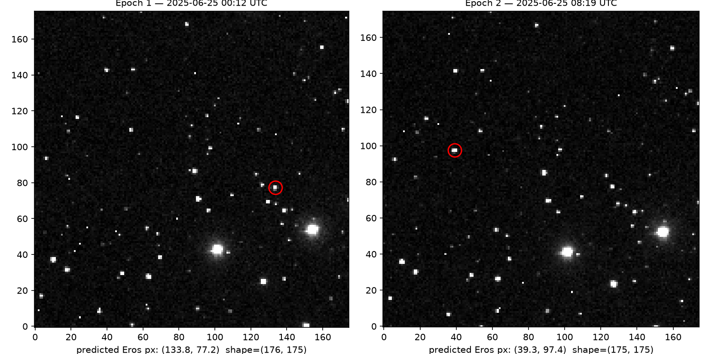
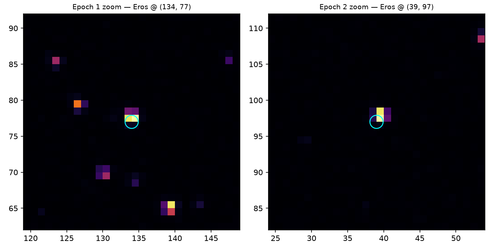

# 🛰️ Skyshift

**A public web tool for the 2026 NASA Space Apps Challenge — "Planet X and SPHEREx"**
*See how the sky, as mapped by NASA's SPHEREx mission, changes over time.*

### 🔗 [**Try the live demo →**](https://skyshift-blue.vercel.app)

> **Status: shipped and live.** Skyshift is a working, deployed app — real SPHEREx archive search, a time-sequence viewer, and citizen-science flagging, all running against a real backend. Built across the Nov 14–15, 2026 Space Apps build weekend. See [`docs/RULES_COMPLIANCE.md`](docs/RULES_COMPLIANCE.md) for the rules this was built under.

**Start here:** [`docs/TEAM_CHARTER.md`](docs/TEAM_CHARTER.md) is the living team charter, architecture, and working agreement — the authoritative plan this README summarizes.

## Contents

- [The challenge](#the-challenge)
- [Judging criteria](#judging-criteria)
- [The concept](#the-concept)
- [Proof it works](#proof-it-works)
- [Team](#team)
- [Plan](#plan)
- [Data](#data)
- [Contributing](#contributing)
- [Community](#community)
- [AI use disclosure](#ai-use-disclosure)
- [License](#license)

## The challenge

Since 2025, NASA's SPHEREx mission has mapped the entire sky every six months in 102 bands of near-infrared light, imaging more than a billion objects. Comets, asteroids, stars, brown dwarfs, and even new planets reveal themselves by shifting position between images — but no one person can sift through all that data alone.

**Our job:** a public-facing web tool that makes it easy for anyone to see how the sky changes over time.

Full breakdown: [`docs/CHALLENGE.md`](docs/CHALLENGE.md)

## Judging criteria

Everything built here is judged on eight criteria, and every design decision should trace back to at least one of them. Full text with a "what wins vs. loses it" breakdown: [`docs/JUDGING_CRITERIA.md`](docs/JUDGING_CRITERIA.md).

| 🔬 Science | 📡 Data access | 🤖 Innovation | 🌍 Impact |
|:---:|:---:|:---:|:---:|
| **📐 Plausibility** | **📖 Storytelling** | **🌐 Global connection** | **🛠️ Craft** |

## The concept

A "planet hunters' blink comparator": search any object by name or by RA/Dec and the live backend queries the real SPHEREx archive, or jump straight into a curated gallery of pre-verified targets as a fast, guaranteed-to-work entry point. Either way, every image traces to its source file, date, and DOI. Visitors can flag anything that moved; flags feed a shared, anonymous, country-level tally of what people around the world have spotted.

MVP scope: [`docs/MVP_CUT_LINE.md`](docs/MVP_CUT_LINE.md)

## Proof it works

This isn't a theoretical concept — it's a live, working app running against the real SPHEREx archive. Search by name or by RA/Dec, and the backend queries real IRSA data, not a fixed gallery. **433 Eros**, confirmed via [IRSA's MOST tool](https://irsa.ipac.caltech.edu/applications/MOST/), moves ~604 arcsec (~98 pixels) across two real SPHEREx cutouts taken ~8 hours apart on 2025-06-25 — a clean, high-SNR (~24–27) detection in both frames:

  
  

Full writeup, exact coordinates, and the query used to find it: [`docs/CANDIDATE_TARGETS.md`](docs/CANDIDATE_TARGETS.md).

**Required SPHEREx data citation, verbatim:**

> This publication makes use of data products from the Spectro-Photometer for the History of the
> Universe, Epoch of Reionization and Ices Explorer (SPHEREx), which is a joint project of the Jet
> Propulsion Laboratory and the California Institute of Technology, and is funded by the National
> Aeronautics and Space Administration.

Full citation list (data sources, libraries, reference tools): [`docs/CREDITS.md`](docs/CREDITS.md). What's checked off for the official submission: [`SUBMISSION_CHECKLIST.md`](SUBMISSION_CHECKLIST.md).

## Team

Mujtaba (frontend, infra, submission) and Athena (backend, agents, data) — see [`docs/TEAM_CHARTER.md`](docs/TEAM_CHARTER.md) for the full ownership split. Still open to more local participants: [`docs/TEAM_ROLES.md`](docs/TEAM_ROLES.md)

## Plan

Three-phase plan from now through the Nov 14–15 build weekend, with kill criteria: [`docs/PLAN.md`](docs/PLAN.md)

## Data

Data contract teammates build against once real data is flowing: [`docs/DATA_CONTRACT.md`](docs/DATA_CONTRACT.md). Plain-language guide to the actual SPHEREx/IRSA file format and how to query it: [`docs/IRSA_DATA_GUIDE.md`](docs/IRSA_DATA_GUIDE.md). Real, verified candidate targets found so far: [`docs/CANDIDATE_TARGETS.md`](docs/CANDIDATE_TARGETS.md)

## Contributing

Read [`CONTRIBUTING.md`](CONTRIBUTING.md) before opening a branch — it's the workflow that keeps a small team from overwriting each other's changes. Task tracking lives on the [Skyshift project board](https://github.com/users/kamikaze1120/projects/1) — pick an open issue there before you start.

## Community

- 🤝 [Code of Conduct](CODE_OF_CONDUCT.md) — the standard we hold ourselves to, in the repo, in team chat, and at the event.
- 🔒 [Security Policy](SECURITY.md) — how to privately report a vulnerability. **Do not** open a public issue for one.

## AI use disclosure

This project uses AI tools (Claude) to accelerate planning and, later, development, per Space Apps' AI-use rules. Ongoing disclosure log: [`AI_USAGE.md`](AI_USAGE.md).

## License

Apache 2.0 — see [`LICENSE`](LICENSE). All data sources and third-party libraries must be cited; see [`docs/CREDITS.md`](docs/CREDITS.md).

---

Built for the 2026 NASA Space Apps Challenge · <a href="docs/TEAM_CHARTER.md">Team Charter</a> · <a href="CODE_OF_CONDUCT.md">Code of Conduct</a> · <a href="SECURITY.md">Security</a> · <a href="LICENSE">Apache 2.0</a>

