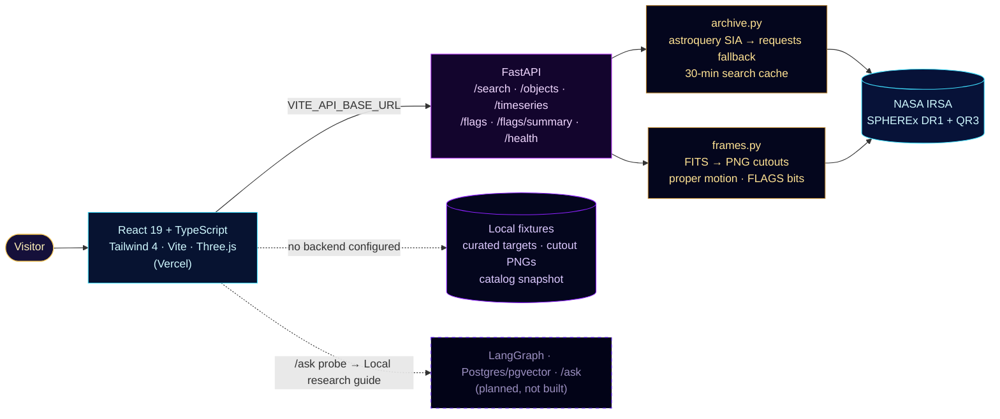

<div align="center">




<p>
  <a href="https://skyshift-blue.vercel.app"></a>
</p>
<p>
  <a href="https://github.com/kamikaze1120/skyshift/actions/workflows/ci.yml"></a>
  <a href="https://github.com/kamikaze1120/skyshift/commits/main"></a>
  
  <a href="LICENSE"></a>
  
</p>

</div>

**Skyshift** is a public web tool built by the Skyshift team for the **2026 NASA Space Apps Challenge — "Planet X and SPHEREx"**. NASA's SPHEREx mission maps the whole sky in near-infrared light every six months; Skyshift lets anyone pick a patch of that sky, blink real SPHEREx images taken on different dates, and see what moved or changed — with every frame traced back to its source file, observation date, and DOI.

<p align="center"><sub><code>SPHEREx</code> ✦ <code>NASA IRSA</code> ✦ <code>BLINK COMPARATOR</code> ✦ <code>CITIZEN SCIENCE</code> ✦ <code>OPEN DATA</code></sub></p>

> **Start here:** [`docs/TEAM_CHARTER.md`](docs/TEAM_CHARTER.md) is the team's living charter, architecture, and working agreement. Decisions are logged, append-only, in [`docs/DECISIONS.md`](docs/DECISIONS.md).

<h2 align="center">✦ THE RULE ✦</h2>
<p align="center"><sub>NO FABRICATED SKY DATA</sub></p>

<table>
<tr>
<td>

**AI may only ever produce queries and prose — never numbers.** Every coordinate, date, flux, wavelength, DOI, and quality flag on screen comes from deterministic code that read it from the archive. This is the non-negotiable design rule in [`TEAM_CHARTER.md` §2](docs/TEAM_CHARTER.md).

**As shipped, it holds by construction:** the backend has no LLM at all. The planned LangGraph agent layer, Postgres/pgvector store, and `/ask` endpoint were descoped during the 48-hour build ([decision log, 2026-11-15](docs/DECISIONS.md)). The frontend's assistant panel still probes `/ask`, gets nothing back, and falls back to a clearly labelled **"Local research guide"** — it never invents an answer about the sky.

</td>
</tr>
</table>

<h2 align="center">◈ WHAT YOU CAN DO ◈</h2>
<p align="center"><sub>EVERY CARD MAPS TO REAL CODE IN THIS REPO</sub></p>

<table>
<tr>
<td width="33%" valign="top">

🔭 **Blink & scrub**<br/>
<sub>Play or scrub through a target's SPHEREx epochs in the sequence viewer to watch motion and brightness changes.</sub>

</td>
<td width="33%" valign="top">

➖ **Difference view**<br/>
<sub>Real per-pixel subtraction between two epochs, drawn on a canvas. If no real second epoch exists it says so instead of faking one.</sub>

</td>
<td width="33%" valign="top">

🎯 **The challenge targets**<br/>
<sub>Barnard's Star, RW Aurigae, R Draconis, WISE 0855-0714 and Epsilon Indi B — plus asteroid 433 Eros.</sub>

</td>
</tr>
<tr>
<td valign="top">

🔎 **Search the archive**<br/>
<sub>By object name or RA/Dec. The backend resolves the name, then pulls matching SPHEREx images from IRSA (DR1 + QR3).</sub>

</td>
<td valign="top">

🧾 **Provenance panel**<br/>
<sub>Source file, observation date, release, DOI, and contamination flags read from the FITS <code>FLAGS</code> layer.</sub>

</td>
<td valign="top">

🌈 **Spectral lens**<br/>
<sub>Step through 102 channels across SPHEREx's six detector bands, 0.75–5.0 µm.</sub>

</td>
</tr>
<tr>
<td valign="top">

🚩 **Flag a mover**<br/>
<sub>Anonymous citizen-science flags. The server keeps only a country tally — no IP, no account, global rate limit.</sub>

</td>
<td valign="top">

📚 **Catalog check**<br/>
<sub>Cross-check against a committed snapshot of real Gaia DR3 and JPL Small-Body Database query results.</sub>

</td>
<td valign="top">

🔗 **Share the exact view**<br/>
<sub>Deep links encode <code>?ra=&amp;dec=&amp;size=</code>, so a shared URL opens the same patch of sky and field of view.</sub>

</td>
</tr>
</table>

<h2 align="center">◆ PROOF IT WORKS ◆</h2>
<p align="center"><sub>433 EROS, TWO REAL SPHEREx CUTOUTS, ~8 HOURS APART</sub></p>

Confirmed with [IRSA's MOST tool](https://irsa.ipac.caltech.edu/applications/MOST/): near-Earth asteroid **433 Eros** moves ~604 arcsec (~98 pixels) between two SPHEREx cutouts taken ~8 hours apart on 2025-06-25 — a clean, high-SNR (~24–27) detection in both frames.

<p align="center">
  
  
</p>

Exact coordinates, the query used, and the other verified targets: [`docs/CANDIDATE_TARGETS.md`](docs/CANDIDATE_TARGETS.md).

<h2 align="center">✦ ARCHITECTURE ✦</h2>
<p align="center"><sub>WHAT ACTUALLY RUNS — PLANNED-BUT-NOT-BUILT PIECES SHOWN DASHED</sub></p>



- **Frontend degrades gracefully.** Every API call (`searchArchive`, `submitFlag`, `getGlobalFlags`, `askSkyshift` in [`frontend/src/lib/api.ts`](frontend/src/lib/api.ts)) returns `null`/`false` on any failure, and the app keeps working on its curated local demo set instead of breaking.
- **Releases are config, not code.** [`backend/releases.py`](backend/releases.py) lists each SPHEREx release, its IRSA collection and DOI — adding a release is a one-line edit ([`docs/DATA_RELEASES.md`](docs/DATA_RELEASES.md)).
- **Moving stars are handled.** Barnard's Star, WISE 0855 and Epsilon Indi B have their proper motion propagated to each observation date before cutouts are made.
- **Honest limits.** Moving solar-system objects need ephemeris-based cutouts, which `/timeseries` does not support yet (it returns `501`); the Eros pair in the app is served from committed cutouts.

<details>
<summary><b>API endpoints</b> (from <code>backend/</code>)</summary>

<br/>

| Method | Route | What it does |
|---|---|---|
| `GET` | `/health` | Liveness check |
| `GET` | `/objects` | The six curated target cards (coordinates, detection status, releases) |
| `GET` | `/timeseries` | Multi-epoch cutouts for `ra`/`dec` or a known `target_id` (`size` 0.01–0.5°, `limit` 2–24) |
| `GET` | `/search` | `q` (name, target, or `"ra, dec"`) or `ra`+`dec` → list of target records |
| `POST` | `/flags` | Record an anonymous flag for a `target_id` (country only, 60/min global cap) |
| `GET` | `/flags/summary` | Flag counts by country |
| `GET` | `/frames/*` | Rendered PNG cutouts (static) |

Response shapes are the Pydantic models in [`schemas/models.py`](schemas/models.py); the contract is documented in [`docs/DATA_CONTRACT.md`](docs/DATA_CONTRACT.md).

</details>

<h2 align="center">◈ TECH STACK ◈</h2>
<p align="center"><sub>REACT FRONT · PYTHON BACK · NASA DATA</sub></p>

<p align="center">
  
</p>

<p align="center"><sub>Frontend: React 19 · TypeScript · Tailwind CSS 4 · Vite · Three.js / @react-three/fiber · Framer Motion · Vitest + Testing Library · oxlint<br/>Backend: FastAPI · Pydantic · Uvicorn · Astropy · astroquery · NumPy · Pillow · Requests · Babel</sub></p>

<h2 align="center">◆ QUICK START ◆</h2>
<p align="center"><sub>FRONTEND ALONE RUNS ON LOCAL FIXTURES · ADD THE BACKEND FOR LIVE ARCHIVE SEARCH</sub></p>

```bash
git clone https://github.com/kamikaze1120/skyshift.git
cd skyshift

# 1) Backend (from the repo root — it imports backend.* and schemas.*)
python -m venv .venv && source .venv/bin/activate   # Windows: .venv\Scripts\activate
pip install -r backend/requirements.txt
CORS_ALLOWED_ORIGINS=http://localhost:5173 uvicorn backend.main:app --reload --port 8000

# 2) Frontend (new terminal)
cd frontend
npm install
echo "VITE_API_BASE_URL=http://localhost:8000" > .env.local
npm run dev        # Vite dev server
```

<details>
<summary><b>Scripts & environment variables</b></summary>

<br/>

| Frontend script | Purpose |
|---|---|
| `npm run dev` | Vite dev server |
| `npm run build` | Type-check (`tsc -b`) and production build |
| `npm run test` | Vitest suite |
| `npm run lint` | oxlint |
| `npm run preview` | Preview the production build |

| Variable | Side | Purpose |
|---|---|---|
| `VITE_API_BASE_URL` | frontend | Backend base URL. Unset → the app runs on its local fixtures only |
| `CORS_ALLOWED_ORIGINS` | backend | Comma-separated allowed origins (default `http://localhost:3000`) |
| `CORS_ORIGIN_REGEX` | backend | Optional regex, e.g. for per-PR Vercel preview domains |
| `PUBLIC_BASE_URL` / `RENDER_EXTERNAL_URL` | backend | Base URL used when building cutout image links |

No database, no LLM key, no secrets required.

</details>

<details>
<summary><b>Project structure</b></summary>

<br/>

```text
skyshift/
├── backend/            FastAPI app
│   ├── main.py         /health /objects /timeseries + curated targets & proper motion
│   ├── search.py       /search — target, "ra, dec", or name resolution
│   ├── archive.py      IRSA SIA queries (astroquery → requests fallback) + cache
│   ├── frames.py       FITS cutouts → PNG, FLAGS-layer contamination bits
│   ├── flags.py        /flags /flags/summary — anonymous, country-only
│   └── releases.py     SPHEREx release registry (collections + DOIs)
├── schemas/models.py   Pydantic API contract
├── frontend/           React + TS + Tailwind app (Vite)
│   ├── src/components/ viewer, scrubber, spectral lens, source/catalog/flag panels
│   ├── src/lib/        API client, image differencing, deep links, releases
│   ├── src/fixtures/   curated targets + Gaia/SBDB catalog snapshot
│   └── public/data/    committed epoch cutouts for the curated targets
├── scripts/            one-off catalog fetch + repo setup helpers
└── docs/               charter, decisions, data contract, IRSA guide, credits…
```

</details>

<h2 align="center">✦ THE DOCS ✦</h2>
<p align="center"><sub>HOW THE TEAM PLANNED, DECIDED, AND VERIFIED</sub></p>

<table>
<tr>
<td valign="top">

**Plan & decide**
- [Team charter](docs/TEAM_CHARTER.md)
- [Decision log](docs/DECISIONS.md)
- [MVP cut line](docs/MVP_CUT_LINE.md)
- [Plan](docs/PLAN.md)

</td>
<td valign="top">

**Data**
- [Data contract](docs/DATA_CONTRACT.md)
- [IRSA data guide](docs/IRSA_DATA_GUIDE.md)
- [Data releases & DOIs](docs/DATA_RELEASES.md)
- [Candidate targets](docs/CANDIDATE_TARGETS.md)

</td>
<td valign="top">

**Challenge & rules**
- [The challenge](docs/CHALLENGE.md)
- [Judging criteria](docs/JUDGING_CRITERIA.md)
- [Rules compliance](docs/RULES_COMPLIANCE.md)
- [Brand compliance](docs/BRAND_COMPLIANCE.md)

</td>
</tr>
</table>

<h2 align="center">◈ CITATION & CREDITS ◈</h2>
<p align="center"><sub>REQUIRED SPHEREx ACKNOWLEDGEMENT, VERBATIM</sub></p>

> This publication makes use of data products from the Spectro-Photometer for the History of the
> Universe, Epoch of Reionization and Ices Explorer (SPHEREx), which is a joint project of the Jet
> Propulsion Laboratory and the California Institute of Technology, and is funded by the National
> Aeronautics and Space Administration.

Data DOIs served by the app: DR1 `10.26131/IRSA678`, QR3 `10.26131/IRSA662` (see [`backend/releases.py`](backend/releases.py)). Full source, library, and reference-tool credits: [`docs/CREDITS.md`](docs/CREDITS.md) · Submission checklist: [`SUBMISSION_CHECKLIST.md`](SUBMISSION_CHECKLIST.md) · AI-use disclosure, per Space Apps rules: [`AI_USAGE.md`](AI_USAGE.md).

<h2 align="center">◆ CONTRIBUTING ◆</h2>
<p align="center"><sub>BRANCH → PR → CHECKS → MERGE</sub></p>

Read [`CONTRIBUTING.md`](CONTRIBUTING.md) first. `main` only takes pull requests, and every PR must pass three checks: a **gitleaks** secret scan, a guard that **blocks raw `.fits` files and anything over 5 MB**, and a **Conventional Commits** PR title. Ownership lanes are in [`CODEOWNERS`](CODEOWNERS); tasks are tracked in [issues](https://github.com/kamikaze1120/skyshift/issues).

[Code of Conduct](CODE_OF_CONDUCT.md) · [Security policy](SECURITY.md) — report vulnerabilities privately, not in a public issue.

<h2 align="center">✦ LICENSE ✦</h2>

<p align="center">Apache 2.0 — see <a href="LICENSE"><code>LICENSE</code></a>. SPHEREx data courtesy of NASA/JPL-Caltech via IRSA.</p>

<br/>

<div align="center">


<sub><code>◉ SKYSHIFT // GILDED ORBIT</code> · built by the Skyshift team · <a href="https://github.com/kamikaze1120">github.com/kamikaze1120</a></sub>

</div>
